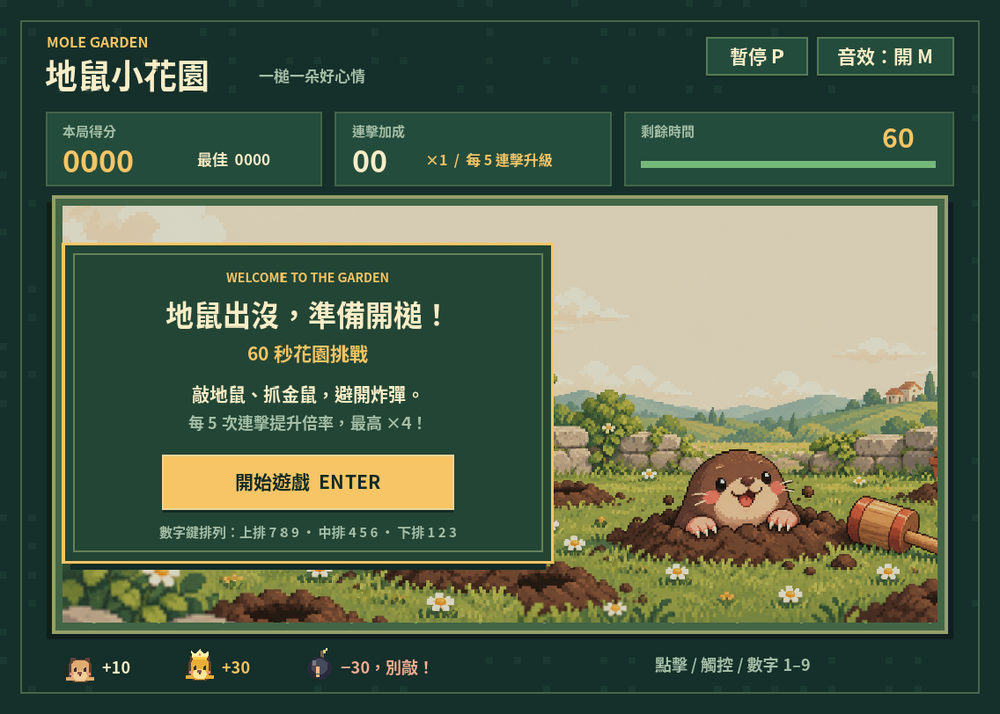
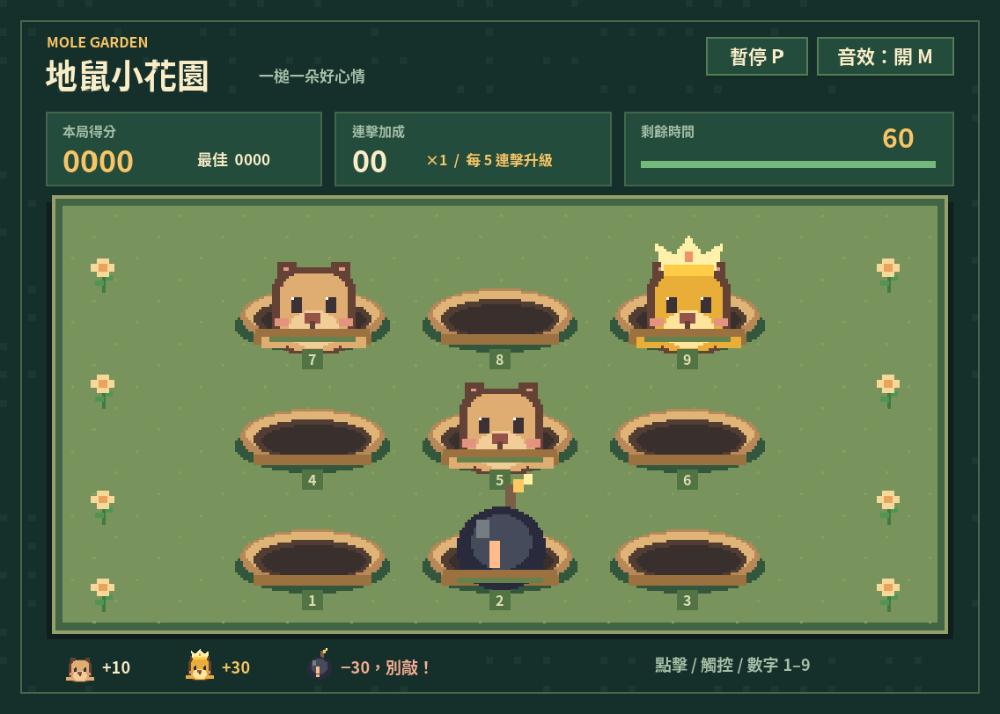

# 地鼠小花園 · Mole Garden

原創像素風打地鼠小遊戲，以 Godot 4.6.3 製作。繁體中文介面、60 秒回合、九宮格、金鼠獎勵、炸彈、連擊倍率、漸進難度、音效與本機最高分。

## 遊戲截圖

### 開始畫面



### 遊戲畫面

九宮格遊戲畫面：普通地鼠、金鼠與炸彈。



## 立即遊玩

此 GitHub 儲存庫提供可編輯的原始專案與素材；不包含已編譯執行檔、Godot 快取或 export templates。可用 Godot 開啟專案，或依下方指令自行匯出各平台版本。

- Windows：解壓縮 Windows 版，雙擊 `MoleGarden.exe`。不需安裝 Godot。
- Linux：解壓縮 Linux 版，執行 `chmod +x MoleGarden.x86_64` 後啟動。
- 網頁版：不可直接雙擊 HTML。於 web 資料夾執行 `python3 -m http.server 8000`，再開啟 `http://localhost:8000/MoleGarden.html`。
- 原始專案：在 Godot 4.6.3 或相容的 Godot 4.x 版本匯入 `project.godot`，按 F6/F5 執行。

## 操作

滑鼠點擊、觸控或鍵盤 1–9。洞穴編號採數字鍵盤的空間排列：第一列 7 8 9、第二列 4 5 6、第三列 1 2 3。鍵盤上方數字列與數字鍵盤都依相同編號操作：7 敲左上角，1 敲左下角；滑鼠與觸控仍直接點選洞穴。

- Enter / Space：開始、再玩一次或從暫停繼續
- P / Esc：暫停或繼續
- M：切換音效
- 切換到其他視窗時會自動暫停

普通地鼠 +10，金鼠 +30，炸彈 −30（最低 0 分）。每 5 次連擊提升一次倍率，最高 ×4；落空、漏掉地鼠或打到炸彈會重置連擊。成功避開炸彈不會中斷連擊。命中率 = 成功命中地鼠 / 出槌次數。

## 素材

`assets/` 的像素角色、洞穴、花朵、槌子、背景與 WAV 音效均為專案原創；`generate_assets.py` 可重建它們（先執行 `python -m pip install Pillow`；字型直接使用隨附檔案）。`gallery/cover.png` 為本遊戲另製的 AI 像素風封面插畫。中文字型取自 Noto Sans CJK TC Bold，以 SIL Open Font License 授權，附於 `assets/FONT_LICENSE.txt`。

## 測試與匯出

```sh
godot --headless --editor --import --path . --quit
godot --headless --path . --script tests/test_game.gd
godot --headless --path . --export-release Windows
godot --headless --path . --export-release Linux
godot --headless --path . --export-release Web
```

需要 Godot 4.6.3 的官方 export templates。61 項自動化測試涵蓋計分、連擊、炸彈、倒數、暫停、重玩、鍵盤與點擊。最高分與靜音設定會儲存在 Godot 的 user:// 資料夾；不使用網路、不收集個人資料。

## 專案結構

- `main.tscn`：主場景
- `scripts/main.gd`：繪圖、遊戲規則、音效、輸入與存檔
- `assets/`：原創像素圖、合成音效、中文字型
- `tests/test_game.gd`：自動化規則測試
- `export_presets.cfg`：Windows / Linux / Web 匯出設定

Windows 版未作商業程式碼簽署，作業系統可能顯示未知發行者提示。網頁版以 WebGL 2 相容模式、非執行緒模式匯出，不需要 SharedArrayBuffer 或跨來源隔離標頭。

## 驗證狀態

- Godot 4.6.3：61 項自動化測試通過；測試關閉存檔，避免影響玩家紀錄。
- 雲端 Linux 圖形介面：繁體中文字、封面、滑鼠開始／繼續、鍵盤得分、暫停倒數及靜音開關已實測。
- 匯出 Linux 執行檔：無畫面啟動測試通過。
- Windows 與 Web：已成功匯出；未在 Windows 電腦或瀏覽器內完成實機測試。
- 觸控：輸入事件自動化測試通過，未以實體手機測試。
- 音效：已產生並載入合成 WAV；雲端環境沒有可用 ALSA 音訊輸出，未驗證實際聽感。
